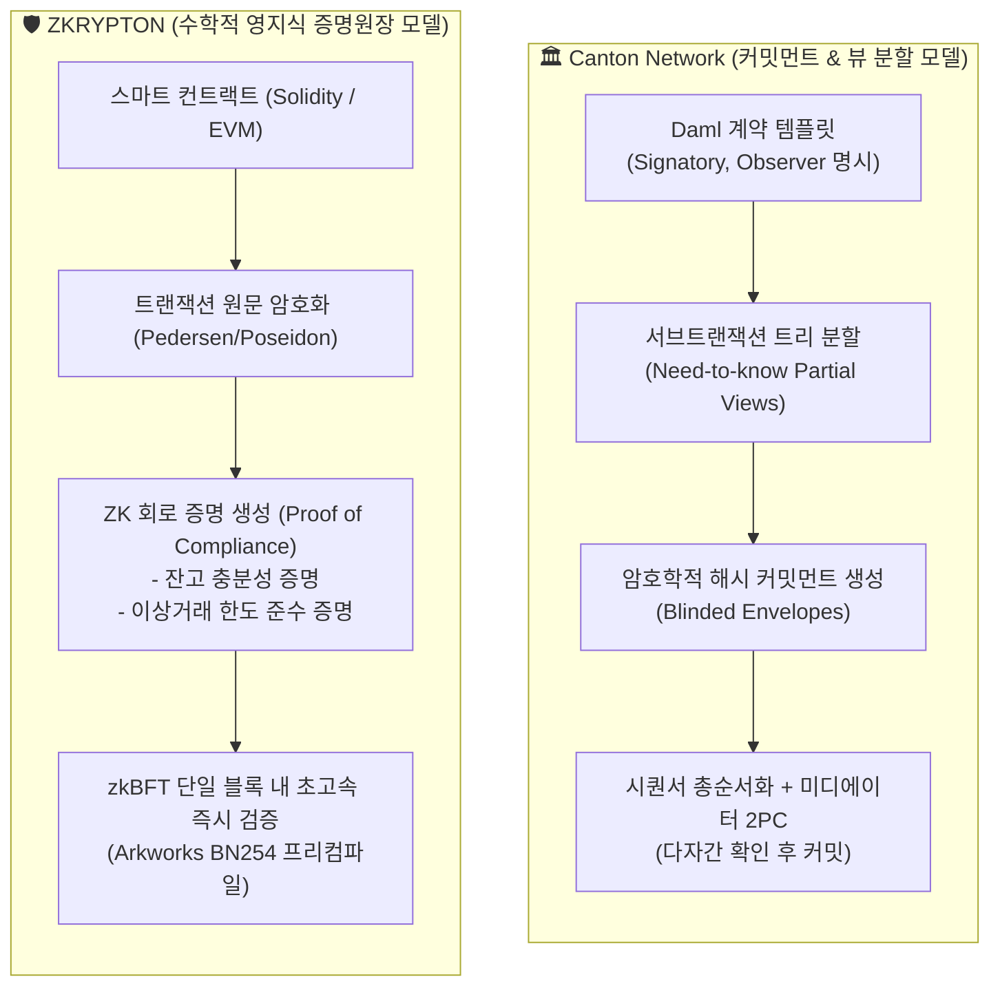

# 🛡️ ZKRYPTON 장단점 분석 및 고객사 질의 대응 종합 FAQ
## 캔톤 네트워크(Canton Commitment) 대비 기관 적합성 평가 & 엔터프라이즈 Q&A

- **문서 번호**: ZK-20261014-FAQ-01
- **최종 수정일**: 2026-10-14
- **대상 독자**: 금융기관(시중은행·증권사), 금융당국(금감원·금융위), 엔터프라이즈 파트너(삼성SDS 등), 사업개발(BD) 및 솔루션 아키텍트

---

## 1. ZKRYPTON의 핵심 장점과 단점 (객관적 분석)

지크립토의 **ZKRYPTON**은 차세대 고성능 이더리움 클라이언트인 **Rust Reth / Revm** 코어를 기반으로, 엔터프라이즈 금융 규제와 기관 간 결제에 최적화된 **zkBFT 합의, 네이티브 계정 추상화(NAA Type 0x7a), Arkworks BN254 영지식 증명(ZKP) 가속 엔진**을 일체화한 차세대 금융 컨소시엄 블록체인입니다.

### 🌟 주요 장점 (Strengths)

1. **Rust Reth / Revm 기반 무결점 고성능 (GC-free Determinism)**:
   - Go(Geth)나 Java(Besu) 기반 체인의 고질적 문제인 **가비지 컬렉터(GC) Pause가 전무**하여, 합의 타이밍 틱 튐이나 트랜잭션 지연 없이 마이크로초 단위의 결정론적 실시간 실행을 보장합니다.
   - **실측 성능**: 네이티브 전송 기준 **최대 6,496 TPS**(Step 10 블록 실측), 복잡한 프라이버시 투표(zkVoting) 기준 **1,500 ~ 3,000 TPS** 검증 완료.
2. **블록 헤더 $O(1)$ 고정 크기 및 zkBFT 즉각 완결성 (Sub-second Finality)**:
   - 검증자 노드가 수십~수백 개로 증가해도 **BLS 집계 서명**을 통해 블록 헤더 크기가 일정하게 유지되어 네트워크 대역폭과 스토리지 비용을 80% 이상 절감합니다.
   - 포크(Fork)가 원천 불가능한 BFT 구조로, **블록 생성 즉시 1초 미만으로 비가역적 확정**을 제공하여 채무자회생법 제120조상 **결제완결성(Settlement Finality)**을 100% 충족합니다.
3. **네이티브 계정 추상화 (NAA, Unsigned Type 0x7a)**:
   - 외부 번들러나 복잡한 EIP-4337 인프라 없이, 기저 프로토콜 레벨에서 **32바이트 인증키, 세션키, 가스 대납(Paymaster), 원화(KRW) 에스크로 사전 차감/정산**을 처리합니다.
   - 기업 고객이 가상자산을 보유하지 않고도 원화 법인계좌로 트랜잭션 수수료를 일괄 정산받을 수 있어 **기업 회계 및 법인세 마찰을 원천 제거**합니다.
4. **Arkworks BN254 ZK 프리컴파일 패치 및 페어링 캐시**:
   - 코어 레벨에서 페어링 연산 캐시(`ZKRYPTON_BN254_PAIR_CACHE_ENTRIES`)를 탑재하여 ZK 증명 온체인 검증 비용(Gas)을 대폭 절감하고, 금융 거래 기밀성을 온체인에서 실시간 검증합니다.
5. **완벽한 EVM 및 Web3 생태계 100% 호환**:
   - Solidity, Foundry, Hardhat, Ethers, Viem, OpenZeppelin 등 수십만 명의 개발자가 사용하는 표준 Web3 도구와 라이브러리를 수정 없이 즉시 사용할 수 있습니다.

---

### ⚠️ 현실적 단점 및 극복 과제 (Weaknesses & Mitigation)

1. **메인넷 장기 실가동 레퍼런스(Track Record) 축적 초기 단계**:
   - DTCC, Euroclear 등 글로벌 메이저 기관 레퍼런스를 보유한 Canton Network나 BlackRock/Visa가 참여한 Circle Arc에 비해, 신생 체인으로서 대규모 기관 운영 이력이 초기 형성 단계입니다.
   - *대응책*: 삼성SDS 협력 과제, 시중은행 예금토큰 PoC 및 공공 zkVoting 성공 레퍼런스를 조기에 확보하여 시장 신뢰 구축.
2. **클라이언트 증명 생성(Prover) 연산 부하**:
   - 온체인 검증(Verification)은 수 밀리초 내로 완료되나, 사용자 디바이스나 클라이언트 단에서 복잡한 영지식 증명(Groth16/PLONK)을 생성할 때 발생하는 CPU/메모리 부하 및 수 초의 대기 시간이 발생할 수 있습니다.
   - *대응책*: 고성능 Prover 서버 클러스터 위임 증명(Delegated Proving) 및 WebAssembly/WebGPU 가속 라이브러리 공급.
3. **Rust 코어 개발 인력의 희소성**:
   - Go나 Java 대비 Rust 기반 블록체인 코어 및 암호학 회로 엔지니어 인력 풀이 전 세계적으로 희소하여 코어 엔진 자체를 고객사가 직접 커스터마이징하기에는 난도가 높습니다.
   - *대응책*: 고객사 SI 및 개발팀은 100% Solidity와 표준 JSON-RPC API만을 다루도록 **체인 어댑터, zkTransfer SDK, 관리자 GUI 툴(ProofLedger)**을 턴키 패키지로 완비.

---

## 2. 암호학적 커밋먼트(Canton) vs 영지식 증명(ZKRYPTON): 기관형 블록체인 적합성 비교

고객사(특히 금융기관 기술기획팀)에서 가장 많이 던지는 핵심 질문 중 하나는 다음과 같습니다:
> **"Canton Network는 Daml과 암호학적 커밋먼트(Commitment)를 활용해 서브트랜잭션을 쪼개서 프라이버시를 보장하는데, 왜 ZKRYPTON은 영지식 증명(ZKP) 방식을 채택했는가? 기관형 블록체인에 어느 쪽이 더 적합한가?"**

### A. 기술 메커니즘 심층 비교

| 비교 항목 | 🏛️ Canton Network (커밋먼트 방식) | 🛡️ ZKRYPTON (영지식 증명 방식) |
| :--- | :--- | :--- |
| **프라이버시 달성 원리** | **접근 제어 기반 뷰 투영 (View Projection)** 계약에 지정된 당사자(Party)에게만 평문 뷰를 전송하고, 외부에는 해시 커밋먼트만 전달 | **암호학적 정보 은닉 (Mathematical Zero-Knowledge)** 원문 데이터를 아무에게도 공개하지 않고, "규칙을 준수했다"는 수학적 증명(Proof)만 온체인 기록 |
| **트랜잭션 구조** | 복잡한 계층형 트리(Tree) 구조로 분할되어 노드마다 서로 다른 상태(State)를 분절 저장 | 표준 이더리움 트랜잭션 및 상태 트리 유지 (EVM 스토리지 정합성 완벽 보존) |
| **정보 누출 (Leakage) 위험** | **메타데이터 누출 위험 존재**: 누가 누구와 거래하는지(트랜잭션 그래프), 커밋먼트 교환 빈도, 블라인드 봉투 크기 등으로 거래 패턴 추정 가능 | **메타데이터 완벽 은닉**: ZK Proof 크기(약 128~256바이트)가 일정하여 거래 상대방과 금액 패턴 추정이 수학적으로 불가능 |
| **합의 및 완결 시간** | **1 ~ 3초 (다단계 2PC)**: 여러 참가자 노드의 승인 서명과 미디에이터 간 왕복 통신(Round-trip) 발생 | **1초 미만 (Sub-second)**: 단일 zkBFT 엔진에서 검증자가 ZK Proof를 밀리초 단위로 검증하고 즉시 확정 |
| **규제 감사 (SupTech) 방식** | **Auditor Node 필수 상주**: 감독당국을 Observer로 계약에 포함시켜 평문 데이터를 직접 수신받아야 함 | **선택적 규제 증명 (Selective Disclosure)**: 영업비밀은 숨긴 채 "자금세탁 미해당 증명", "준비율 충족 증명"만 감사관에 제공 |
| **개발 언어 및 툴체인** | **Daml (독자 함수형 언어)** 기존 Web3 자산 및 이더리움 라이브러리 사용 불가 | **Solidity 100% (표준 EVM)** OpenZeppelin, Foundry, Hardhat 등 기존 자산 완벽 재사용 |

---

### B. 기관형 블록체인으로서의 종합 적합성 판정

> **결론: "국내 제도권 금융(은행, 증권사, STO, 원화 결제) 및 규제 환경에는 ZKRYPTON이 Canton Network보다 훨씬 실용적이고 우수한 적합성을 제공합니다."**

1. **개발 및 운영 현실성 (EVM 생태계 vs Daml 사일로)**:
   - Canton은 우수한 금융 설계를 갖추었으나, 난해한 **Daml 언어 강제**로 인해 국내 시중은행 및 증권사 SI 프로젝트에서 개발자 확보와 기존 계정계/정보계 연동에 극심한 병목을 초래합니다.
   - ZKRYPTON은 **표준 Solidity 100% 호환**이므로, 국내 금융 SI 인력들이 즉시 투입되어 스마트 컨트랙트를 구축할 수 있습니다.
2. **수수료 및 법인 회계 (NAA 0x7a vs 비정형 과금)**:
   - Canton은 도메인별 복잡한 인프라 과금 모델을 가지나, ZKRYPTON은 **네이티브 계정 추상화(NAA 0x7a)**를 통해 가스비 원화 정산 및 대납(Paymaster)을 네이티브로 지원하여 기업 회계팀의 승인을 즉각 획득할 수 있습니다.
3. **감독당국의 감사 부담 (감사관 풀노드 구축 vs 가벼운 ZK 검증기)**:
   - Canton은 금융감독원이 거래 내역을 보려면 직접 노드를 설치하고 관리해야 하지만, ZKRYPTON은 감독당국에 **가벼운 영지식 검증 라이브러리**만 제공해도 금융기관의 거래가 법정 한도를 지켰는지 100% 수학적으로 확신할 수 있습니다.

---

## 3. 고객사 실무 질의 대응 대규모 종합 FAQ (20선)

---

### 📂 카테고리 1: 코어 아키텍처 및 성능 (Architecture & Performance)

#### Q1. ZKRYPTON의 실측 TPS는 얼마이며, 스트레스 테스트 검증 기준은 무엇인가요?
- **답변**: ZKRYPTON은 4개 검증자 노드로 구성된 E2E 분산 환경에서 부하 테스트(Step 1~10)를 완료했습니다. 단순 토큰 전송(Native Transfer)의 경우 **블록 트랜잭션 포함 최대 6,496 TPS**를 기록했으며, 복잡한 영지식 검증이 수반되는 프라이버시 투표(zkVoting)의 경우에도 **1,500 ~ 3,000 TPS**를 안정적으로 처리합니다. 이론적 한계치는 100,000+ TPS에 달합니다.

#### Q2. 기존 이더리움 클라이언트(Geth, Besu) 대신 왜 Rust 기반 Reth/Revm을 채택했나요?
- **답변**: Go 언어(Geth)나 Java(Besu)는 런타임에 주기적으로 실행되는 **가비지 컬렉터(GC) Pause**로 인해 순간적인 시스템 멈춤 현상이 발생하여 합의 라운드 타임아웃이나 금융 트랜잭션 지연을 유발합니다. Rust 기반 Reth/Revm은 GC가 없어 마이크로초 단위의 **결정론적 실시간 처리(Deterministic Execution)**를 보장하며, 메모리 충돌 취약점을 컴파일 타임에 100% 방지합니다. 또한 글로벌 최첨단 ZK 라이브러리(Arkworks)와 무오버헤드로 직접 결합할 수 있습니다.

#### Q3. zkBFT 합의 알고리즘의 'Stable Leader N-블록 재임(Tenure)' 알고리즘이란 무엇인가요?
- **답변**: 매 블록마다 리더가 바뀌는 기존 BFT 체인은 빈번한 리더 선출 통신 오버헤드로 인해 지연시간이 길어집니다. ZKRYPTON의 zkBFT는 신뢰할 수 있는 리더가 $N$개 블록(예: 8블록) 동안 연속으로 블록을 제안하는 **Stable Leader Tenure** 방식을 적용하여 합의 메시지 교환 횟수를 획기적으로 줄이고 네트워크 파이프라인 처리량을 극대화합니다.

#### Q4. 블록 확정성(Finality)은 몇 초이며 포크(체인 분기)가 발생할 수 있나요?
- **답변**: ZKRYPTON은 비트코인이나 이더리움 같은 확률적 완결성(Probabilistic Finality)이 아닌, **결정론적 완결성(Deterministic Finality)**을 제공합니다. 블록이 생성되는 즉시 **1초 이내(Sub-second)**에 100% 비가역적으로 확정되며, 네트워크 파티션이 발생해도 분기(Fork)가 절대 발생하지 않습니다. 이는 증권 결제 및 금융 계정계의 필수 요건입니다.

---

### 📂 카테고리 2: 프라이버시 및 영지식 증명 (Privacy & ZKP)

#### Q5. 영지식 증명(ZKP)을 쓰면 트랜잭션 검증이 너무 느려져서 금융 시스템에 부적합하지 않나요?
- **답변**: 흔히 ZKP가 느리다고 하는 것은 **증명 생성(Proving)** 단계의 연산 때문이며, **증명 검증(Verification)**은 원래 수 밀리초 내로 끝납니다. ZKRYPTON은 코어 엔진에 **Arkworks BN254 고속 프리컴파일**과 **페어링 연산 캐시(`PAIR_CACHE_ENTRIES`)**를 탑재하여, 블록 검증자가 ZK 증명을 검증하는 데 소모되는 가스와 시간을 80% 이상 단축했습니다. 따라서 초당 수천 건의 ZK 트랜잭션을 실시간 검증할 수 있습니다.

#### Q6. Canton Network의 Daml 커밋먼트 방식과 ZKRYPTON의 영지식 증명 방식의 차이는 무엇인가요?
- **답변**: Canton의 커밋먼트 방식은 계약 코드를 뷰(View) 단위로 쪼개어 접근 권한이 있는 사람에게만 암호화 봉투를 주는 **접근 제어 분할 모델**입니다. 반면 ZKRYPTON은 데이터를 아무에게도 까서 보여주지 않고, "이 거래가 법정 한도와 잔고 규칙을 지켰다"는 사실만을 수학적으로 증명하는 **완전 기밀성 모델**입니다. ZKRYPTON은 데이터 뷰 분할의 틈새로 발생하는 거래 패턴(메타데이터) 유출조차 원천 차단합니다.

#### Q7. ZKRYPTON에서 금융 프라이버시 트랜잭션은 구체적으로 어떻게 동작하나요?
- **답변**: 송금인의 계좌 잔고와 송금 금액은 Poseidon 해시 함수로 암호화(Commitment)된 상태로 온체인에 기록됩니다. 송금 시 송금인은 "내 잔고가 송금액보다 크거나 같으며, 출금 후 잔고가 음수가 되지 않는다"는 사실을 입증하는 영지식 증명(Proof)을 함께 제출합니다. 검증자 노드는 금액 원문을 보지 않고도 해당 증명만을 검증하여 트랜잭션을 승인합니다.

#### Q8. zkVoting(프라이버시 전자투표)은 어떤 원리로 비밀투표와 결과 검증을 양립하나요?
- **답변**: 유권자의 신원과 투표 내용은 ZK 암호화로 은닉되어 누구도 특정인이 어떤 후보에게 투표했는지 알 수 없습니다. 동시에 "유권자가 정당한 투표권을 가졌으며, 중복 투표를 하지 않았다(Nullifier 검증)"는 사실은 수학적으로 100% 증명되어, 투표함 집계 결과의 무결성을 전 세계에 투명하게 공개할 수 있습니다.

---

### 📂 카테고리 3: 금융 규제 및 컴플라이언스 (Regulation & Compliance)

#### Q9. 전자금융감독규정 제15조(금융 망분리) 규제를 ZKRYPTON으로 충족할 수 있나요?
- **답변**: 네, 완벽히 충족합니다. ZKRYPTON 노드는 금융기관 내부 업무망(코어 뱅킹)에 완전히 격리된 채 설치될 수 있습니다. 외부 검증자 노드와의 합의 통신은 금융보안원 기준을 만족하는 **mTLS 보안 게이트웨이 및 암호화 IPC 채널**을 통해서만 이루어지며, 고객 개인정보나 코어뱅킹 데이터는 외부망으로 일절 유출되지 않습니다.

#### Q10. 퍼블릭 블록체인의 최대 문제인 금융실명제 및 개인정보보호법(잊힐 권리)을 어떻게 해결했나요?
- **답변**: ZKRYPTON은 주민등록번호, 실명, 계좌번호 등 개인식별정보(PII)를 블록체인에 평문으로 결코 기록하지 않습니다. 모든 고객 신원은 금융사 내부 CRM에만 보관되며, 온체인에는 무작위 암호키와 ZK 증명만 기록됩니다. 따라서 거래 비밀보장 의무를 지키며, 회원 탈퇴 시 오프체인 매핑 키를 파기함으로써 개인정보보호법상 잊힐 권리를 100% 만족합니다.

#### Q11. 금융감독원이나 한국은행이 거래를 실시간으로 감사(SupTech)하려면 어떻게 해야 하나요?
- **답변**: ZKRYPTON은 **"선택적 규제 증명(Selective Disclosure / Proof of Compliance)"** 아키텍처를 제공합니다. 금융기관의 거래는 시장에 기밀로 유지되지만, 스마트 컨트랙트 정책에 따라 금융감독원 전용 감사 키(Auditor Key)로는 거래 명세가 실시간 스트리밍되거나, "해당 거래가 외환송금 한도($50,000)를 초과하지 않았다"는 ZK 증명이 감독원 대시보드로 자동 전달됩니다.

#### Q12. 토큰증권(STO) 제도화 법안(전자등록법·자본시장법)에서 요구하는 계좌관리기관 요건을 만족하나요?
- **답변**: 네, ZKRYPTON은 금융위 토큰증권 가이드라인을 완벽히 수용합니다. 증권사/신탁사가 계좌관리기관으로서 권리자 명부와 분산원장 간 1:1 일치를 유지할 수 있는 스마트 계약 표준을 제공하며, 투자자의 키 분실이나 법원 판결 시 스마트 컨트랙트 레벨에서 강제 집행할 수 있는 **사법 강제 이전 및 재발행(Force Transfer / Recovery)** 권한을 탑재하고 있습니다.

---

### 📂 카테고리 4: 비즈니스, 회계 및 가스비 모델 (Business & Accounting)

#### Q13. 기업 고객이 블록체인을 쓸 때 가상자산(코인)을 회계장부에 잡는 것을 극도로 꺼리는데, 해결책이 있나요?
- **답변**: 이것이 ZKRYPTON을 도입해야 하는 결정적 이유입니다. ZKRYPTON의 **네이티브 계정 추상화(NAA Type 0x7a)**는 프로토콜 단에서 **가스비 대납(Paymaster)**을 지원합니다. 기업 고객은 암호화폐를 단 1원도 매수하거나 보유할 필요가 없으며, 시스템 운영사나 금융사가 원화(KRW) 법인 계좌를 통해 트랜잭션 비용을 월별 정산(OPEX 비용 처리)해 줄 수 있습니다.

#### Q14. Circle Arc는 USDC를 가스비로 쓴다고 하는데, ZKRYPTON의 가스비 모델과 비교하면 어떤가요?
- **답변**: Circle Arc는 미국 달러(USDC)를 수수료로 쓰는 글로벌 체인으로 해외 결제에는 유리하지만, 국내 금융기관 입장에서는 여전히 '외화 가상자산 보유'에 따른 외환관리법 및 법인세 과세 리스크가 남습니다. 반면 ZKRYPTON은 **국내 원화(KRW) 에스크로 정산 모델**을 제공하므로 국내 법인세법 및 금융 회계 기준에 100% 부합합니다.

#### Q15. 엔드유저(일반 사용자) 입장에서 지갑 설치나 시드 구문 보관 없이 핀테크 앱처럼 쓸 수 있나요?
- **답변**: 가능합니다. ZKRYPTON NAA(Type 0x7a)는 스마트폰의 생체 인증(FaceID, 지문) 기반 **Passkey / WebAuthn** 서명을 네이티브로 수용합니다. 사용자는 난해한 12단어 시드 구문을 적어둘 필요 없이, 토스나 카카오페이를 쓰듯이 지문 인증 한 번으로 블록체인 트랜잭션을 전송할 수 있습니다.

#### Q16. 프라이빗 엔터프라이즈 환경에서 가스비(수수료)를 0원(무료)으로 설정할 수도 있나요?
- **답변**: 네, 허가형 컨소시엄 모드에서는 정책 엔진(Policy Engine)을 통해 지정된 금융기관 및 허가된 스마트 컨트랙트 호출에 대해 **가스비를 0으로 설정(Gas-free Whitelisting)**할 수 있습니다. 스팸 공격 방지는 PoW/가스비 대신 허가된 노드의 전송 쿼터(Rate Limiting) 정책으로 완벽히 통제합니다.

---

### 📂 카테고리 5: 보안, 운영 및 시스템 구축 (Security & Operations)

#### Q17. 검증자(Validator) 노드의 개인키 탈취나 서명 키 분실에 대한 안전장치는 무엇인가요?
- **답변**: ZKRYPTON은 4단계의 다층 방어 체계를 갖추고 있습니다:
  1. **원격 서명자(Remote Signer)** 및 하드웨어 보안 모듈(HSM/sHSM) 연동
  2. **Monotonic Signing Floor(`SafetyTransactionV1`)**: 동일 라운드에 두 번 서명(이중 서명/슬래싱 사고)하는 것을 메모리 및 디스크 레벨에서 원천 차단
  3. **State WAL / Signing WAL 이원화 영속성**: 노드 비정상 셧다운 후 재기동 시 0.1초 내로 이전 합의 상태를 100% 무손실 복구
  4. **AMD SEV 기밀 컴퓨팅 및 eBPF/SELinux**: 호스트 OS 침해 시에도 노드 내부 메모리 유출 차단

#### Q18. 노드 서버 장애 발생 시 서비스 무중단 고가용성(HA)은 어떻게 보장되나요?
- **답변**: zkBFT 합의 알고리즘에 따라 전체 $3f+1$ 검증자 중 $f$개의 노드가 물리적으로 다운되거나 해킹당해도 네트워크 전체는 단 1초의 중단도 없이 정상적으로 블록을 생성하고 확정합니다. 장애 노드가 복구되면 P2P 동기화 프로토콜을 통해 누락된 블록을 즉시 고속 다운로드하여 동기화합니다.

#### Q19. 기존 시중은행이나 증권사의 레거시 코어 시스템(계정계/정보계)과의 연동은 얼마나 쉬운가요?
- **답변**: Canton Network는 독자적인 gRPC Ledger API를 공부해야 하지만, ZKRYPTON은 전 세계 표준인 **이더리움 JSON-RPC (`eth_*`)**를 지원합니다. 기존 엔터프라이즈 시스템은 검증된 Ethers.js, Web3j(자바 스프링), Python Web3 SDK를 통해 REST API 연동하듯 손쉽게 트랜잭션을 전송하고 이벤트를 수신할 수 있습니다.

#### Q20. 하이퍼레저 패브릭(Hyperledger Fabric)을 쓰던 고객사가 ZKRYPTON으로 전환해야 하는 가장 큰 이유는 무엇인가요?
- **답변**: 
  1. **운영 복잡도 제거**: 패브릭의 악명 높은 오더러(Orderer), 피어(Peer), CA, 채널(Channel) 설정 지옥에서 벗어나 단일 바이너리 기반의 심플한 노드 운영이 가능합니다.
  2. **성능 10배 향상**: 수백 TPS에 불과한 패브릭 대비 실측 6,000+ TPS의 성능을 제공합니다.
  3. **스마트 컨트랙트 재사용**: 패브릭 전용 체인코드(Go/Java) 대신 전 세계 표준인 **Solidity 생태계의 모든 라이브러리를 그대로 활용**할 수 있습니다.
